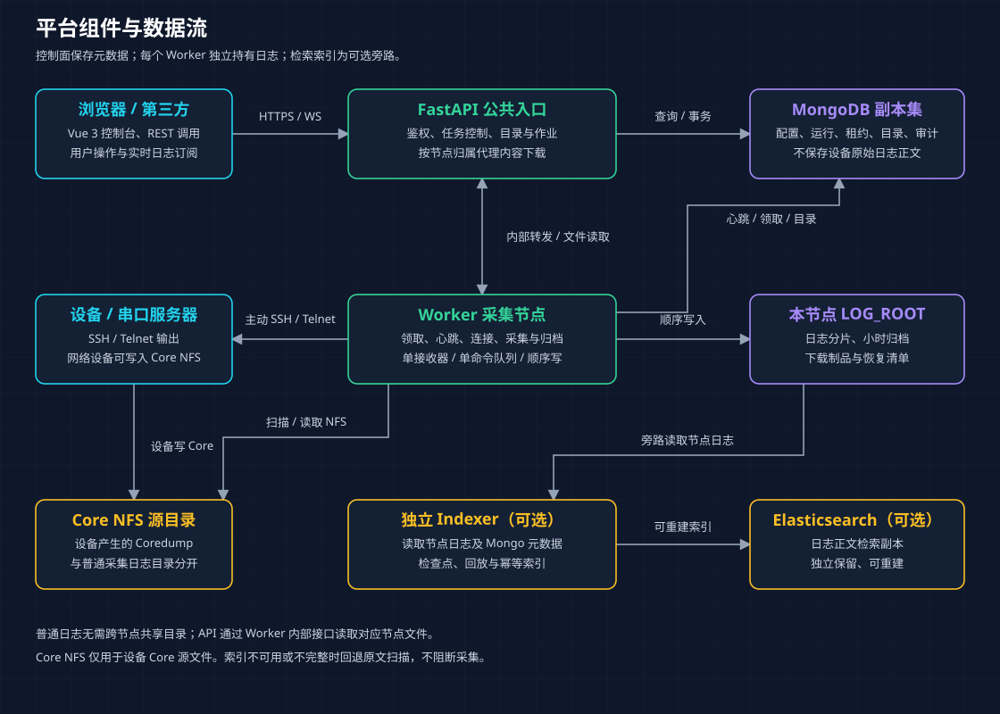
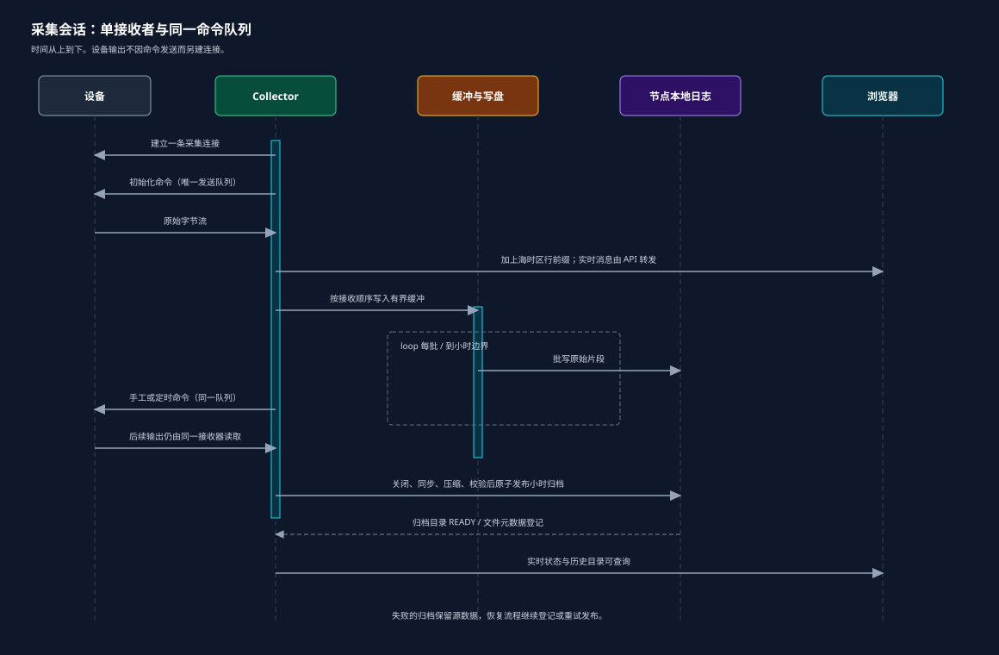
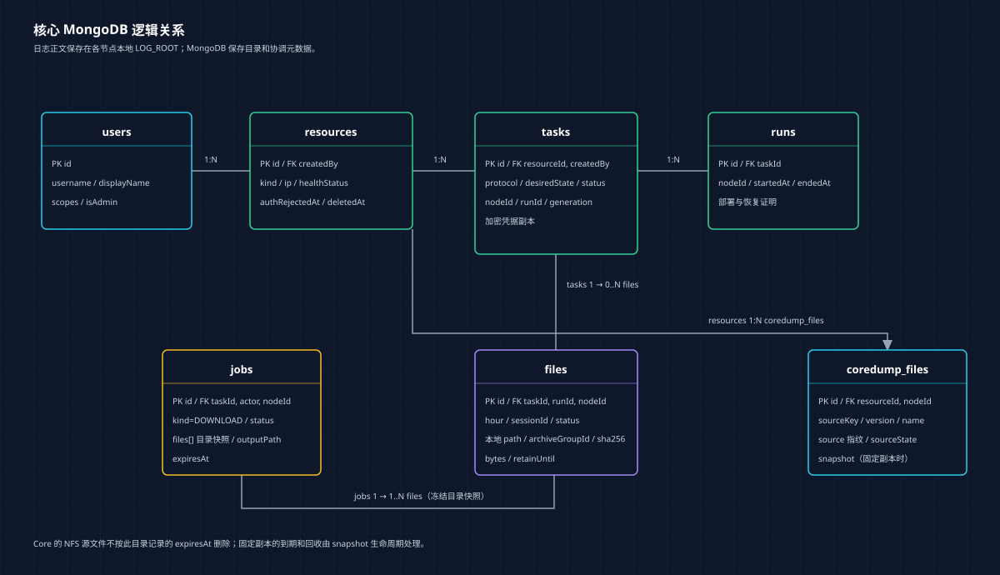
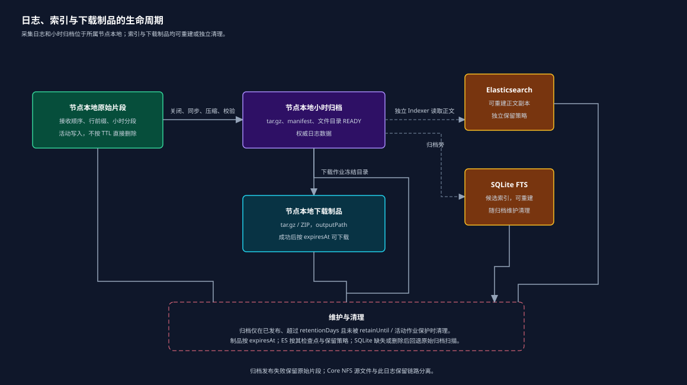
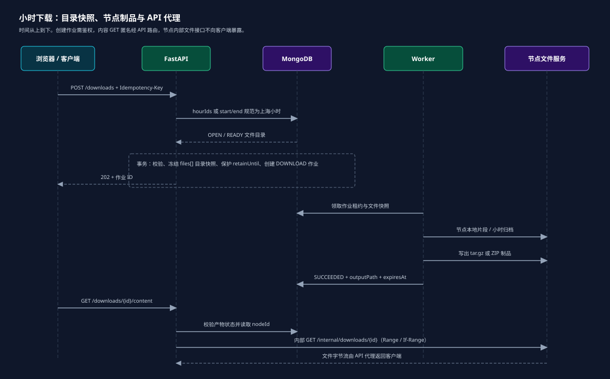
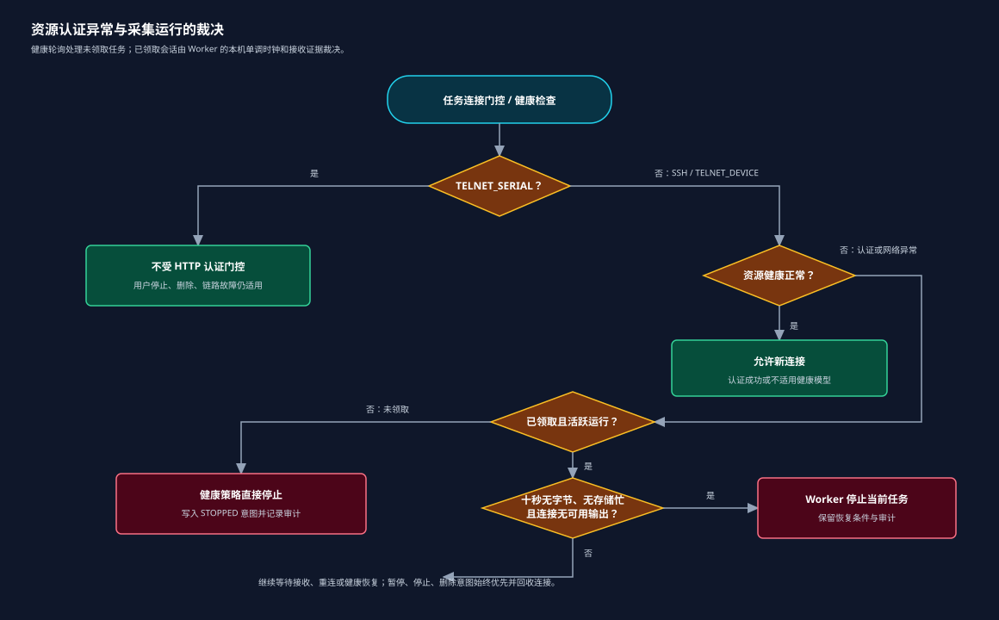

# Camera Log Record Server

面向摄像机、网络设备与 Telnet 串口的日志采集、归档、检索和运维平台。平台通过 SSH、Telnet 设备或 Telnet 串口持续接收设备输出，在采集节点本地按小时可靠保存；控制台和第三方调用正式 API 管理资源、任务、命令、下载与审计。MongoDB 保存配置、运行状态、目录、审计和检索元数据，**不保存设备原始日志正文**。

系统将持续采集、设备连接、任务调度、文件归档、历史查询和运营治理按模块分开维护，同时保持每条设备连接的有序写入、可追溯操作与受控恢复。当前实现、已验证范围与待现场验收项以 [实现状态总表](docs/implementation-status.md) 为准；本机短时合成测试不代表生产容量结论。



## 目录

- [能力概览](#能力概览)
- [核心约束](#核心约束)
- [系统架构与数据关系](#系统架构与数据关系)
- [模块与目录](#模块与目录)
- [快速开始](#快速开始)
- [部署模式与配置](#部署模式与配置)
- [设备、资源与任务](#设备资源与任务)
- [日志采集、归档与检索](#日志采集归档与检索)
- [Core、下载与公开访问](#core下载与公开访问)
- [看板、资源监控与控制台导航](#看板资源监控与控制台导航)
- [后台平台配置](#后台平台配置)
- [API、WebSocket 与鉴权](#apiwebsocket-与鉴权)
- [节点、监控、调度与恢复](#节点监控调度与恢复)
- [后台治理、审计与保留](#后台治理审计与保留)
- [开发、测试与运维](#开发测试与运维)
- [文档索引](#文档索引)

## 能力概览

| 领域 | 能力 | 重要边界 |
| --- | --- | --- |
| 资源管理 | 海康网络设备 ISAPI 认证、Telnet 串口服务器登记、筛选、批量操作和软删除 | 密码只加密保存，不在列表、审计、日志或响应中回传 |
| 任务与命令 | SSH、Telnet 设备、Telnet 串口采集；初始化、手动、定时命令；模板与批量控制 | 同一会话只有一个接收器和发送队列；结果不明的写入不整批重试 |
| 日志工作台 | 实时 WebSocket、缺口补读、小时目录、历史检索、下载与导出 | 实时窗口是受预算限制的视图，不是日志权威副本 |
| 存储归档 | 上海时间前缀、按字节上限动态分片、校验后原子发布小时包、目录恢复与清理 | 原始正文在采集节点文件；MongoDB 只保存元数据和目录 |
| Core | NFS 发现、稳定性判定、冻结副本、导出、存在提示和历史资源重新关联 | 稳定源文件可按 ID 与 Range 读取；不稳定且无快照时拒绝下载 |
| 检索 | 原文跨分卷搜索、渐进结果、取消收尾、可选 Elasticsearch 旁路索引 | 索引失败不阻断采集或原文检索；索引是可重建副本 |
| 节点与运维 | 心跳、遥测、准入、调度、受控隔离、跨 Worker 接管、JSONL 日志 | 心跳丢失本身不是旧节点已经隔离的证明 |
| 后台治理 | 用户、服务账号、IP 策略、审计、运行事件、请求诊断与保留设置 | 密码、令牌和授权头递归脱敏；设备正文不入库 |

## 核心约束

- 每个采集会话只有一个接收器、一个命令发送队列和一个顺序写入器。相同日志正文不去重，接收顺序就是写入顺序。
- 每个逻辑行在收到时以 `Asia/Shanghai` 首字节到达时间添加 `[YYYY-MM-DD HH:MM:SS] ` 前缀；跨网络分包的一行只添加一次。实时推送、节点文件、归档、下载和检索使用同一份加前缀字节。
- SSH 与 Telnet 设备支持暂停：关闭当前连接、保留运行和定时预算、禁用自动重连；恢复时复用运行并重新初始化。Telnet 串口不支持暂停。停止后再次启动产生新的运行。
- 默认连续 10 秒没有真实设备输出，采集器关闭会话并进入重连流程。SSH 使用协议 keepalive；Telnet 使用 IAC NOP 与 TCP keepalive。存储阻塞不被当作设备静默。
- 网络设备的 HTTP/ISAPI 健康认证和日志连接相互独立：已有有效 SSH/Telnet 设备连接持续输出时，认证异常不应打断采集。Telnet 串口不依赖认证状态；尚未领取的网络设备任务仍须满足准入与认证规则。
- 设备正文和下载正文不写入 MongoDB。设备与任务凭据以加密密文保存，普通查询不返回；归档与原始文件是权威来源。可选 Elasticsearch 仅保存受保留策略约束、可重建的检索副本。

## 系统架构与数据关系

浏览器、第三方系统和管理员经反向代理访问 FastAPI。API 负责鉴权、资源与任务合同、目录与下载作业，并根据文件目录中的节点归属访问 Worker 内部文件接口。设备不会连接 WebSocket；WebSocket 仅用于浏览器订阅实时日志。



`Resource` 表示设备或串口服务器；`Task` 绑定资源、采集协议和凭据；一次启动产生 `Run`，每次建连产生 `Session`。日志目录指向节点上的小时归档与分卷，下载作业冻结所选范围。Core 发现记录与资源身份、节点和可选冻结副本关联。



日志在接收路径完成时间前缀与顺序写入，并严格按当前字节上限分卷；片段首末接收时间只用于命名。封存时校验目录、摘要和字节数，临时文件同步后原子发布。发布后的原始分卷由归档流程清理；下载作业和导出产物有独立过期时间，保留任务会保护仍被读取的产物。



## 模块与目录

```text
backend/camera_logs/
  common/             配置、MongoDB、响应合同、鉴权、时区、脱敏、可观测性与内部节点 HTTP
  access_policy/      来源 IP 范围与资源访问策略
  resources/          设备资源、认证记录、健康策略与资源生命周期
  tasks/              采集任务、模板、调度、领取、控制与软删除
  commands/           初始化/手动/定时命令、常用命令与执行预算
  collection/         连接适配器、Collector、会话运行时、保活与 Core 监控绑定
  logs/               行前缀、分卷、目录、归档、实时尾随、搜索、下载作业和保留维护
  coredumps/          NFS 扫描、身份关联、稳定/冻结快照、导出与事件
  indexing/           可选 Elasticsearch 旁路索引、检查点与回放
  node/               Worker、遥测、内部文件 API、运行时回收、隔离与故障转移
  resource_metrics/   资源 CPU/内存历史指标与日历查询
  dashboard/          控制台看板汇总
  administration/     后台设置、审计、运行事件和请求记录
  reference/          从运行时 API 合同生成的说明、示例与操作目录
  users/              用户、会话、服务账号与权限
  main.py              FastAPI 公共入口
  worker.py            Worker 兼容启动入口
frontend/src/
  app/                应用装配、路由与工作台骨架
  features/
    access/ auth/ audit/ commands/ coredumps/ dashboard/ logs/
    nodes/ resources/ settings/ tasks/ templates/    按业务边界拆分的界面
  shared/             共享类型、请求客户端、组合式逻辑和通用 UI
deploy/               Docker 镜像、Compose、MongoDB 初始化、Nginx 与 Worker 启动定义
scripts/              验证、浏览器冒烟、基准、部署诊断、开发产物清理和 Git 钩子
tests/                Python 单元、合同、事务、部署与集成回归
diagram/readme/       README 架构、关系、时序和策略图
docs/                 架构、API、部署、保留、运维、验收和历史记录
pyproject.toml        Python 包、依赖、pytest 与 Ruff 配置
frontend/package.json 前端依赖、开发、测试和构建命令
deploy-all.sh         Docker 完整部署入口
deploy-native.sh      原生部署入口
```

`camera_logs.main:app` 是公共 HTTP/WebSocket 入口，`camera_logs.worker` 是 Worker 启动入口。API 与 Worker 共享数据库合同，但采集文件留在各自节点；跨节点读取通过受控 `NODE_URL` 的内部接口，不依赖共享本地路径。

## 快速开始

前提：Python 3.12、Node.js 和可用的 MongoDB **副本集**。开发也需要事务能力，单节点副本集即可；`directConnection=true` 只影响客户端拓扑发现，不会让独立 MongoDB 实例具备事务能力。副本集初始化、目录与恢复步骤见 [Docker 部署](docs/deployment.md) 和 [原生部署](docs/native-deployment.md)。复制示例配置后，必须改成本机可达的数据库和节点配置；不要提交 `.env`、密钥、口令或设备连接信息。

```sh
python3 -m venv .venv
.venv/bin/python -m pip install --upgrade pip
.venv/bin/python -m pip install -e '.[test]'
cp .env.example .env
# 编辑 .env：MONGO_URI 指向本地副本集；LOG_ROOT 使用可写的本地目录；
# NODE_ID 必须唯一；NODE_URL/NODE_PORT 必须与本机 Worker 实际监听地址一致。
# .env.example 的 mongo1/mongo2/mongo3、worker:18081 是容器部署示例，不能直接用于此本地命令。
# 用受限环境变量或密钥管理系统写入 ENCRYPTION_KEY、BOOTSTRAP_TOKEN、INTERNAL_TOKEN。
# Fernet 密钥可用：.venv/bin/python -c "from cryptography.fernet import Fernet; print(Fernet.generate_key().decode())"
.venv/bin/uvicorn camera_logs.main:app --host 0.0.0.0 --port 8000
```

另一个终端启动 Worker：

```sh
.venv/bin/python -m camera_logs.worker
```

启动前端：

```sh
cd frontend
npm ci
npm run dev -- --host 0.0.0.0 --port 5173
```

前端开发代理把 `/api` 及实时 WebSocket 转到 `http://127.0.0.1:8000`，因此上述 API 端口需要保持一致，或同步调整 [vite.config.ts](frontend/vite.config.ts)。API 启动时直接校验 `ENCRYPTION_KEY` 与 `BOOTSTRAP_TOKEN`，初始化索引并只在空库创建管理员；`INTERNAL_TOKEN` 用于 API 与 Worker 的内部请求认证，应与两端一致配置。`ADMIN_USERNAME` 与 `ADMIN_PASSWORD` 仅在空库初始化时使用，既有管理员不会被覆盖；首次登录后必须修改口令。示例配置仅是变量说明，不能作为可直接投产的安全配置。

最小使用路径：登记网络设备或 Telnet 串口服务器，创建独立采集凭据的任务，启动后在日志工作台订阅实时输出，在小时目录和下载/搜索作业中处理历史数据，再用审计、运行事件、请求记录和节点看板排障。

## 部署模式与配置

### Docker 完整平台

Linux 主机使用完整入口部署前端、API、Worker 与三成员 MongoDB 副本集。首次先生成配置，审核数据根目录、端口、保留期、节点地址、网络和密钥来源后再启动：

```sh
./deploy-all.sh --init
# 审核并编辑受限 .env
./deploy-all.sh
```

`deploy-all.sh` 兼容 `deploy.sh`。独立组件入口为 `deploy-frontend.sh`、`deploy-backend.sh`、`deploy-worker.sh` 与 `deploy-database.sh`；跨机拓扑由 `--multi-host` 和部署配置共同约束。脚本保留已有环境、数据卷、日志与已修改的管理员信息，不会初始化时清空数据。完整步骤、端口、TLS、反向代理和跨机注意事项见 [Docker 部署](docs/deployment.md)。

### 原生部署

Ubuntu/Debian 上可由 systemd、Nginx 与本机依赖运行：

```sh
sudo bash ./deploy-native.sh all --config /etc/camera-logs/native.env
```

详见 [原生部署](docs/native-deployment.md)。

### 关键配置原则

| 配置 | 用途与要求 |
| --- | --- |
| `MONGO_URI`、`DATABASE_NAME` | 连接目标和数据库名称。生产部署依赖支持事务的副本集；副本集名称由实际 URI 决定，不能在 README 中固定为 `rs0`。副本集不复制 Worker 本地日志。 |
| `ENCRYPTION_KEY`、`BOOTSTRAP_TOKEN`、`INTERNAL_TOKEN` | 都应仅通过密钥管理或受限环境注入。API 启动直接校验前两项；`INTERNAL_TOKEN` 用于 API 与 Worker 的内部请求认证，必须在两端保持一致。 |
| `ADMIN_USERNAME`、`ADMIN_PASSWORD` | 仅用于空库首次管理员初始化；已存在的管理员不会被覆盖。README 不展示默认口令。 |
| `HOST_LOG_ROOT`、`API_DATA_ROOT` | 分别决定采集节点文件与 API 服务日志/临时下载位置；迁移前停止对应服务并完整迁移。 |
| `NODE_ID` / `COLLECTOR_NODE_ID`、`NODE_URL` / `COLLECTOR_NODE_URL`、`NODE_BIND_IP`、`NODE_PORT` | 节点 ID 必须稳定唯一；公布 URL 必须是 API 可控且可达的 Worker 地址；绑定地址和端口只影响 Worker 的内部监听。Docker 配置使用 `COLLECTOR_*` 名称，运行时读取对应节点设置。 |
| `LOG_ROOT`、`NFS_ROOT`、`NFS_SERVER_IP` | 分别是节点日志根、Core NFS 根与设备可达的 NFS 主机 IP；`NFS_SERVER_IP` 不能填写容器服务名或容器回环地址。 |
| `RETENTION_DAYS` 与后台保留设置 | 控制日志、下载产物和业务记录的清理；缩短前评估审计、恢复和合规影响。 |
| `SSH_VERIFY_HOST_KEY`、`KNOWN_HOSTS` | 默认兼容设备更换；严格模式由节点本地受控 known_hosts 文件约束 SSH 主机密钥。 |
| `PSH_MODE`、`PSH_*` | PSH 默认禁用。启用后 URL、客户端标识、密钥和本地 mock 口令文件必须从受限环境提供，URL 中不得嵌入凭据。 |
| `ELASTICSEARCH_*` | 仅启用可选旁路索引器。索引故障不应阻断采集、归档或原文检索。 |

不要把用户名、密码、令牌、Fernet 密钥、MongoDB 密码或第三方服务密钥写进 README、脚本、浏览器地址、终端历史或诊断报告。

## 设备、资源与任务

- **海康网络设备**：以 Digest（默认）或 Basic 的 ISAPI 认证读取设备信息，保存型号、短序列号和版本等非敏感属性。资源 HTTP 凭据只用于认证与健康判断。
- **Telnet 串口服务器**：保存名称、地址和端口等信息，可作为网络设备下的串口采集目标或独立资源。
- **身份连续性**：网络资源软删除后，若以相同 IP、型号和子序列号重新认证添加，符合身份条件的历史 Core 目录可重新关联，保留原文件 ID、首次发现时间和事件，不伪造新的首次发现。
- **软删除与批量处理**：任务和资源删除保留必要的审计与日志保留语义。删除资源会关闭或阻止其活跃采集，默认列表排除已删除记录；既有归档按保留期而不是立即销毁。

初始化命令是有序数组，每条命令按自己的换行符、提示符、延迟和超时发送，服务不会把多条命令拼接成 shell 表达式。初始化、手动和定时命令复用同一会话发送队列。定时命令预算和发送快照在发送前持久化；发送结果不确定则标记为未知，不自动补发。

模板复制配置但不共享任务计数。命令历史、常用命令与批量操作均受权限、版本和审计约束。详见 [设备资源](docs/device-resources.md)、[命令预约](docs/command-reservations.md) 与 [批量操作](docs/bulk-operations.md)。

### 连接初始化、主从机与 PSH

SSH 任务可选择 `HOST` 或 `SLAVE_1` 至 `SLAVE_3`。从机先完成独立协议与目标身份确认，运行期间每 60 秒复用当前采集连接执行 `ifconfig` 复核身份；无法确认或身份变化会关闭该会话并重新切换，不消耗用户的定时命令预算。SSH 主机和 `TELNET_DEVICE` 会尽力完成 ASH 识别/握手，失败不替代采集错误语义；`TELNET_SERIAL` 保持串口传输行为。

连接后的初始化命令按数组顺序逐条进入唯一发送队列，分别应用换行符、延迟、提示符和超时，绝不拼接成 shell 语句。设备输出控制使用既定的 `outputClose`、`outputOpen` 等命令顺序；PSH `debug` 交互会按密码提示分片写入，已经确认 ASH 时跳过重复握手。PSH 默认关闭，生产解密与第三方凭据只能从受限环境注入；操作细节见 [PSH 调试](docs/psh-debug.md) 和 [PSH 生产运行](docs/psh-production.md)。

### 控制台任务操作

资源和任务列表都有创建人列、创建人筛选、归属权限和软删除视图；模板列表提供创建人和归属筛选，其删除/可见性遵循模板自身 API 合同。资源页显示每资源任务数，统计和活动采集均排除软删除记录；任务页支持冻结当前选择后逐项删除、部分失败结果与刷新，取消或改选不会发送删除请求。模板复制的是命令配置快照，不共享执行计数。

“常用命令”是管理员维护的全局快捷命令，支持分页、模糊查询、启用状态筛选、创建、编辑、启停和批量操作；启用项会进入手工命令输入的补全。所有更改通过乐观版本、权限和审计记录保护。

## 日志采集、归档与检索

每个任务的文件按任务、上海日期和小时组织。小时内 `.log` 分片由**字节上限**切分，名称包含安全任务名、设备 IP、首末接收时间和唯一分片信息；逻辑小时的归档名仍以小时范围表达。分片大小由平台设置动态控制：默认 10 MiB，允许 10–100 MiB 且以 5 MiB 为步长。新设置在后续新分片生效，不改写历史归档。

一个任务在同一逻辑小时的已完成分片会聚合为一个 `.tar.gz`。归档发布前校验成员、摘要和字节数，临时文件同步后原子发布；失败保留恢复材料和诊断，不把不完整产物标为可下载。单小时下载返回该小时包，多小时下载返回包含多个小时包的 ZIP；Range 下载支持断点读取。

- 实时输出通过 WebSocket 按任务订阅，首次打开从服务端当前可用帧开始。实时缓冲是可配置的内容预算，超限淘汰最旧内容；显式缺口可以通过目录/片段字节接口补读。
- 小时目录按 `Asia/Shanghai` 自然日筛选，显示运行/会话片段、原始与归档大小、可用性与完整性。
- 历史搜索在原文与目录上执行，支持跨分卷匹配、渐进结果、取消和清理。候选索引不完整、损坏、短词或不可用时回退原文扫描，不能把候选索引结果当作最终正文。
- 无时区输入按上海时区解释；对外业务时间以 `+08:00` 表示，数据库内部和兼容标识仍可使用 UTC/既有格式。

检索速度、范围与已验证边界见 [日志检索性能合同](docs/log-search-performance.md)。

### 下载范围操作

先通过日志日历取得任务的上海自然日，再从小时目录取得 `hourIds`。创建下载时，`hourIds` 与 `start`/`end` 时间范围严格二选一：范围必须同时传起止时间，无时区时间按 `Asia/Shanghai` 解释，起点包含且落入所在小时，终点不包含并向上覆盖到小时边界；终点恰好为整点时不多取下一小时。单次最多 168 小时，预估源数据上限为 20 GB；缺片默认失败，只有 `allowPartial=true` 才产生部分下载包。

下载作业冻结文件身份和水位。单小时返回仅含日志成员的 `.tar.gz`，多小时返回 ZIP STORE，每小时一个日志包；完成后可以 Range / If-Range 断点读取。作业执行时限和成功产物保留期独立，已生成的历史内容 URL 在产物保留期内仍可匿名使用。

## Core、下载与公开访问

网络设备任务可启用 NFS Core 监控，Worker 在受控 NFS 根目录扫描和记录发现状态。Core 文件先判断稳定性；稳定且源仍存在的文件可按稳定 ID 流式读取并支持 Range。源文件不稳定、不可读或已经移除时，只有可用冻结副本才允许继续读取；导出产物有独立作业与到期时间。



以下精确匹配的 `GET` 内容路由是匿名附件读取接口：无需登录 Cookie、Bearer Token、下载票据或来源 IP 授权，残留无效凭据也不改变读取语义：

- `/api/v1/downloads/{identifier}/content`
- `/api/v1/coredumps/{identifier}/content`
- `/api/v1/coredump-exports/{identifier}/content`

这不是目录、搜索、创建作业、管理或任意 API 的匿名访问。目录、创建、取消和管理接口仍经过用户鉴权、资源权限与来源策略检查；内容 URL 仍受产物状态、过期时间、源文件稳定性、读取租约及 Range 规则保护。稳定且仍存在的 Core 源文件可直接按 ID 下载，**无需先导出**；导出只用于批量打包或冻结副本。不要把下载正文写入业务数据库或审计记录。NFS 权限、网络边界和部署见 [NFS Core 部署](docs/nfs-coredump-deployment.md)。

## 看板、资源监控与控制台导航

登录后的控制台以资源工作台为默认入口，并在资源、任务、日志工作台、Core、节点看板、后台配置和审计与事件之间导航。导航按用户权限显示；资源和任务支持“仅看自己”、创建人筛选、已删除记录视图和关联工作台跳转。日志工作台必须先选择任务，再在实时打印、小时归档与检索、命令记录间切换。

平台看板汇总当前资源、有效采集任务、选定上海自然日的日志量、设备日志排行、Core 发现和 Worker 健康。设备排行最多显示 Top 10，排行榜截断不截断总统计；趋势基于已登记目录和保留期内数据，不承诺表示即时磁盘 I/O 或永久历史总量。

资源监控可折叠显示 CPU/内存监视配置和历史趋势。资源详情的趋势弹窗支持预设范围、自定义时间范围、CSV 导出和有采样日期的月份日历。已删除资源只可读取保留期内历史：预设范围截止于删除时间，日历展示旧采样日期，不重新启用监控、不续租旧采样任务，也不自动刷新。资源监控、Core 与采集连接共享既有连接边界，不因此额外建立 SSH 会话。

## 后台平台配置

后台配置分为平台与容量、节点准入、资源监控和记录保留模块。平台与容量集中设置集群/节点预算、日志实时显示预算、日志分片大小（10–100 MiB、5 MiB 步长）和服务运行日志保留期；节点准入管理容量与压力策略；资源监控控制采样与历史记录；记录保留控制增长型业务记录的生命周期。普通用户只读其可见的最小配置，管理员的写入有版本与审计保护。

API 与 Worker 的服务 JSONL 以上海自然日目录存储，默认保留 7 天；同一天达到 20 MiB 时滚动为编号分片。缩短保留期会触发清理，未知文件、子目录和软链接不会被猜测删除。设备小时归档、下载制品、Core 冻结副本、认证记录和运行/审计记录分别使用各自的保留与恢复语义，详见 [数据库与文件保留](docs/database-retention.md)。

## API、WebSocket 与鉴权

公共 API 使用 `/api/v1` 前缀。请求模型、路径参数和查询参数由运行时 Pydantic 模型提供中文字段说明；JSON 响应由响应模型校验，OpenAPI 与控制台 API 文档直接从实际合同生成。错误响应包含稳定错误码与 `requestId`，避免把内部异常、密码、令牌或原始请求内容返回给调用方。

| 接口类别 | 说明 |
| --- | --- |
| 认证与用户 | Cookie 会话、用户、角色、资源范围、服务账号和来源 IP 策略。 |
| 资源与任务 | 资源认证、资源/任务/模板 CRUD、任务控制、批量操作和命令管理。 |
| 日志与下载 | 小时目录、片段读取、历史搜索、下载/导出作业、进度和内容流。 |
| Core | 文件目录、发现事件、过滤、冻结副本、导出和稳定源文件读取。 |
| 节点与后台 | 节点登记、心跳、遥测、健康、准入、设置、请求记录、审计与运行事件。 |

实时日志通过 WebSocket 传递订阅、状态、正文和缺口帧。WebSocket 在握手阶段验证会话、来源与资源权限，帧模型与 API 文档同源。接口示例、权限要求、错误码和帧见 [API 文档](docs/api.md)；用户、服务账号和 IP 控制见 [登录与访问控制](docs/user-access.md)。

## 节点、监控、调度与恢复

Worker 通过 MongoDB 写入平台接收时刻的心跳，并上报 CPU、内存、磁盘、网络、采集输入与写入延迟等遥测。节点时间偏差不会被直接当作离线：持续心跳按平台接收时刻判断，节点自身时间只作诊断。遥测缺失、过期或首个差分样本显示未知，而不是零负载。

调度器为新的待运行任务筛选可用节点并重新检查容量、准入、资源压力、节点隔离和任务意图。运行中的任务不会为了均衡负载主动迁移。磁盘、CPU、内存、写入延迟等阈值会限制新连接；严重磁盘压力可停止已有采集并留下可排障状态。



当节点故障需要接管时，平台首先要求外部隔离或已停止的可信证明。确认旧运行关闭后，仍要求运行的任务可以由其它合格节点创建新运行继续采集，旧日志不会迁移；用户暂停和停止意图保持原状。无法证明旧连接已关闭时保持隔离，避免同一设备产生并发采集连接。

归档、目录和下载作业具有重启恢复路径：Worker 维护持久清单、受限队列与退避重试，API/Worker 重启后可补偿已发布目录；校验失败保留文件并记录故障，不能伪造缺失正文。详见 [节点健康与调度](docs/node-health-scheduling.md)、[节点故障转移与实时窗口](docs/node-failover-and-live-window.md) 和 [日志作业恢复](docs/log-job-recovery.md)。

节点遥测的网络速率原始单位为 B/s，看板换算为十进制 Mb/s；采集输入则按 KiB/s、MiB/s 展示。用于准入的 `writeLatencyMs` 是每个运行时最近 60 秒“批处理排队加写入”延迟的 P99 与当前未完成批的等待时间取较大值，再在本节点运行时之间取最大值；它不等同于端到端采集延迟。实际写入指标 `writeIoLatency*` 使用独立的 60 秒窗口及独立的待完成时间；批次等待与底层写入阶段诊断另有最多 1,024 个样本的统计窗口。这些 P99 的采样起止和样本集合不同，不能直接相加得到写入延迟。遥测与短时压力测试用于调度保护，不能替代真实多节点、长期生产容量验收。

## 后台治理、审计与保留

后台配置按平台与容量、节点准入、资源监控、记录保留等模块组织。资源 CPU/内存历史允许查询已删除资源的历史时间窗，但已删除资源不会继续采样或保留旧采样租约；资源指标日历仅标示实际有采样的上海日期。

审计记录记录谁在何时发起何种业务操作及目标范围；运行事件记录采集、节点、归档等状态变化；请求记录用于 HTTP 排障。三者支持按受限字段检索。响应校验失败或内部错误应先用 `requestId` 查询请求记录，再按 API/Worker JSONL 核对安全诊断。访问日志在响应完成后写入 `responseComplete` 与 `responseBytes`，HTTP 状态码本身不等于客户端一定保存了下载文件。

| 对象 | 保留与恢复语义 |
| --- | --- |
| 设备小时归档与节点原文件 | 默认期限可配置；下载保护、读者租约和维护状态会阻止提前删除。 |
| 下载与 Core 导出产物 | 作业完成后按产物保留期限到期；执行上限与成功产物保留期分别管理。 |
| 服务 JSONL | 按上海自然日目录切分和清理；未知文件、子目录和软链接不会被清理程序猜测删除。 |
| 认证记录 | 默认有独立 TTL；同日、同身份、同来源的连续相同结果可合并计数。 |
| 审计、运行事件、命令与操作记录 | 根据后台策略保留；新增 TTL 或索引须同时考虑增长、查询、幂等和恢复。 |
| Elasticsearch 副本 | 可重建、独立保留、独立删除；不影响原始归档的权威性。 |

完整的集合、索引、TTL、增长估算与清理边界见 [数据库与文件保留](docs/database-retention.md)、[记录治理与恢复](docs/record-governance-and-recovery.md) 和 [开发产物清理](docs/development-cleanup.md)。开发清理默认预览；只有具备完整来源和一致性证据的压测下载副本才能用 `--apply` 删除，服务端真实设备日志不在该范围内。

## 开发、测试与运维

修改代码前同步影响图谱；修改 API、文件格式、实时显示或保留行为时，同时核对正式合同、恢复路径和相应验证证据。

```sh
codegraph sync .
codegraph impact SessionRuntime
```

基础验证：

```sh
pytest -q
ruff check backend tests scripts
cd frontend
npm test
npm run build
```

影响布局、下载或实时展示时运行浏览器冒烟并检查桌面与移动端截图：

```sh
node scripts/browser_smoke.mjs
```

部署前安装 Git 钩子：

```sh
scripts/install-git-hooks.sh
```

提交信息使用中文标题，正文包含“背景：”“变更：”“测试：”“影响：”。仓库 CI 会校验该约定。容器、原生部署、跨 Worker、NFS、Elasticsearch、浏览器和事务的专项入口位于 `scripts/`，证据与当前未完成项汇总在 [验证说明](docs/validation.md) 和 [实现状态总表](docs/implementation-status.md)。

| 现象 | 首先检查 |
| --- | --- |
| API 返回 500 或响应校验错误 | 用 `requestId` 查询“审计与事件 → 请求记录”，再检查 API JSONL 的安全诊断。 |
| 日志实时窗口有缺口 | 查询任务小时目录与片段可用性，使用字节范围补读；检查节点连接和 WebSocket 状态。 |
| 下载状态成功但文件不完整 | 检查访问日志 `responseComplete`、下载作业状态、产物到期时间和节点文件可用性。 |
| 节点离线或无法领取任务 | 核对平台接收心跳、遥测新鲜度、准入、隔离、容量、磁盘和写入延迟。 |
| 归档未出现或恢复失败 | 检查 Worker 清单、摘要/字节校验、持久重试状态与节点日志；保留失败文件，勿手工标记 READY。 |
| Core 无法下载 | 核对源文件稳定性、节点可达性、冻结副本、文件仍存在状态与导出产物过期时间。 |

## 文档索引

| 主题 | 文档 |
| --- | --- |
| 当前实现、验证与待验收边界 | [实现状态总表](docs/implementation-status.md)、[历史记录](docs/history/README.md) |
| 架构与运行时约束 | [架构与设计](docs/architecture.md)、[节点健康与调度](docs/node-health-scheduling.md) |
| Docker、原生和跨机部署 | [Docker 部署](docs/deployment.md)、[原生部署](docs/native-deployment.md)、[节点部署排障](docs/node-deployment-troubleshooting.md) |
| API、权限与账户 | [API 文档](docs/api.md)、[登录与访问控制](docs/user-access.md) |
| 设备、NFS 与命令 | [设备资源](docs/device-resources.md)、[NFS Core 部署](docs/nfs-coredump-deployment.md)、[PSH 调试](docs/psh-debug.md) |
| 日志检索、恢复与性能 | [日志检索性能合同](docs/log-search-performance.md)、[日志作业恢复](docs/log-job-recovery.md)、[服务基准](docs/service-benchmark.md) |
| 可选 Elasticsearch 索引 | [Elasticsearch 旁路索引](docs/elasticsearch-sidecar.md) |
| 数据保留与清理 | [数据库与文件保留](docs/database-retention.md)、[记录治理与恢复](docs/record-governance-and-recovery.md)、[开发产物清理](docs/development-cleanup.md) |
| 审计与验证 | [验证说明](docs/validation.md)、[批量操作](docs/bulk-operations.md)、[命令预约](docs/command-reservations.md) |

---

维护本 README 时，以实际运行时代码、OpenAPI/帧模型和 [实现状态总表](docs/implementation-status.md) 为事实来源。新增接口、集合、持续写入、下载路径或恢复行为时，同步更新合同、保留说明、验证证据和本导航。
