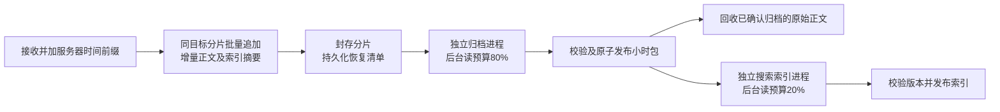

# 2026-10-30 下午：百设备自动化接入、写入隔离与归档流程优化

## 目标和证据边界

业务基线为 `a3fe8f8`，期间独立规范提交 `6fb8a48` 已保留。本轮针对自动化平台并行管理上百设备、频繁设备重启、订阅重试及任务/资源删除，优化少数慢会话对节点准入的影响，并审查归档流程和API/Worker运行日志。原始 `/Users/geekingdommac/NFS/testLogs` 只读，不触碰公司服务或数据库。

API：2098条完整JSON，1条截断末行，时间15:31:35–15:49:08；Worker：24080条完整JSON，时间10:13:19–15:57:19，均为上海时间。用户节点截图16:08:58晚于日志终点，截图的17.7秒与53个归档不能与日志逐请求或逐心跳绑定。日志未提供构建标识，不能确认现场部署提交。

API的105个WebSocket均以1000关闭，没有错误类型；生命周期中位30.068秒，观测平均并发约5、峰值7。这份日志本身不能证明当时已有100个并发连接。另有105次请求事件副写超时，不等于HTTP业务请求失败。

Worker有76次归档候选spool在打开时ENOENT，出现在10:20:37–13:42:23。它证明枚举与打开之间文件不可用，不证明是谁删除或NFS缓存就是唯一原因。14:44–15:32的写压切换值约3.5–6.5秒，与此前spool错误不是同一时间窗口；不能直接把全部写压归因于归档。运行状态显示明显重连波动，仍缺少同刻写入阶段和执行器快照。

## 写入延迟含义与修复

节点 `writeLatencyMs` 是活动会话最近60秒的最大会话P99或最大未完成批次年龄，不是全节点平均或全局样本P99。批次等待、单次I/O P99是不同样本集合，分位数不能相加；端到端还包含锁、槽位等待和多次文件操作。保持原值供排查，不以平滑或提高阈值隐藏慢会话。

已复现两个确定性写入问题：

1. 原跨小时、容量或回拨分支对120个小块执行约120次追加调度；同文件连续内容现在合并为一批。正文顺序、重复行、序号、源块偏移和回拨边界均保持，部分写入失败不重放。
2. 原封存清单准备和fsync使用默认后台线程池，默认池全部占用时会阻塞新小时写入，即使采集专用线程有空闲。清单持久化现在使用有界采集I/O槽并纳入实际I/O计时；取消继续等待物理操作收尾，不丢恢复入口。

明确失败的批次结束后清除未完成计时；仍在物理I/O中的批次不伪造结束，不释放其线程或文件锁。

## 少数慢会话与节点整体准入

新增 `writeAdmission`，保持真实最差延迟。超限时只有同时满足下列条件才把问题归为SESSION告警而保留新任务准入：

- 慢会话不超过 `max(1, writeConcurrency // 4)`，且少于活动会话的一半。
- 至少另一个会话存在最近窗口内成功写入样本，不能把零样本视为健康。
- 写入执行槽有空余、无排队等待者，应用缓冲小于90%。

写槽耗尽、缓冲背压、异常范围扩大、只有一个慢会话且没有正常会话证据，或诊断不足时仍保守阻断。旧节点缺字段时保留原阈值规则；管理员修改阈值后不采信旧阈值下的结论。前端明确展示“最慢会话写入延迟”，同时展示当前准入原因，避免高最差值被误解为所有任务都慢。

## 小时归档方案与摘要生成时机

现有正文及旁路索引SHA256在每次成功追加时增量更新；完整片段在封存时记录大小、序号和服务器首末接收时间。达到容量上限后，下一次追加前切换分片；跨小时、回拨或会话关闭时组装已封存片段清单。摘要并非等到整点才重扫正文计算。

因此不采用“每满一个片段就重建同一个小时压缩包”：它可能反复解压、合并、校验和重压已发布内容，放大I/O。继续保留原始分片及增量摘要，把持久清单交给后台处理；只有归档原子发布并校验后才回收对应原始正文。用户提出的提前分散工作目标由增量摘要、边界批量化和执行器隔离实现。

已复现长时间搜索索引占用原唯一进程时，后来归档必须等待。现在归档与索引各使用一个有界独立进程，已运行索引不阻止后来归档；归档不再内联建索引，检索在索引未就绪时仍回退原文。总生效后台预算按80/20拆分，例如50MiB/s对应归档40、索引10，常态不再绕过读取限速。两个执行器均有进展监控及受控退出回收。

扫描到但打开已消失的spool不再通过第二次exists判定为积压；可解析清单中引用正文缺失仍进入发布校验并报警。该修复防止幻影候选污染waiting/oldest，不据此断言截图53项全部虚假。

## 订阅与运行日志

节点内存tail在无新帧时最多等待1秒，收到帧后立即唤醒；使用条件锁避免空读到等待之间漏通知。客户端断开取消在途操作，停止/运行替换结束旧实例等待。每轮仍校验身份、权限与任务；不缓存跨请求授权。旧Worker忽略新增内部参数时保持原行为。

API访问完成和请求事件副写结果合为一条记录：业务耗时在响应结束冻结，副写耗时另记，副写失败为WARNING并保留请求ID、安全错误类型和有限栈位置。取消不伪造副写成功。WS记录固定关闭来源/原因及认证、任务读取、tail、空tail计数，不保存Token、Cookie、游标或正文。

写压变化/持续异常/恢复记录最慢任务、运行、会话，端到端/I/O/缓冲/执行器/事件循环快照；持续异常30秒一次，最慢会话变化也有最小冷却。独立watchdog按真实调度采样，长停顿不通过补采样制造额外异常值。归档/索引作业记录排队、执行、完成、失败或取消，使用安全归属、关联摘要及阶段耗时，不为写日志额外读盘。正常取消不当作发布失败退避；第三方httpx/asyncssh/telnetlib3保留WARNING以上，平台业务状态、访问和审计不静默。

## 验证状态

- 跨边界批写回归先3项失败，修复后通过；默认后台池占满的小时切换先失败后通过。存储相关55项通过。
- 本机100写入器、3轮会话重建及跨小时，共150MiB正文，两个会话阻塞期间其他98个完成；600次文件批量追加、600份清单摘要校验、代表任务三次会话合并的两个小时包校验通过。临时目录已清理；这是本机合成文件系统测试，不代表公司NFS容量。
- 本机真实Mongo+HTTP/WS：100并发×3轮，601次tail（300订阅各2次及一次撤销验收），三轮残留调用均0；通过公开接口撤销专用令牌后4401关闭且无残留tail。节点用真实wait_tail但没有物理设备，不能冒认为100实体设备全天验收。
- 最终后端全量2213项通过（264.31秒），Ruff与差异格式检查通过；前端226项、生产构建和35组生产浏览器全部通过，1440/390节点状态截图已目检。
- 隔离真实Worker、真实WebSocket及浏览器小时下载通过；随机数据库和模拟日志目录均由脚本清理。
- 最终百写入复验：两个会话阻塞时其他98个完成耗时184.719ms，三轮各约251/271/250ms；百订阅复验三轮tail零残留，撤销4401且零残留，资源请求P99为116.804ms。均是本机短时测试，不能转换为公司长期容量承诺。
- 独立审查准入、阈值变更、心跳、取消和文档合同，175项相关测试通过；主线程补充实际节点接口非空writeAdmission返回覆盖。索引队列收尾修复后关联120项及最终全量通过。
- 本轮专属Mongo确认仅admin/config/local后关闭并删除专属数据目录；挂起的旧测试进程及其子进程已回收。原始公司日志未改动。
- 本记录随功能提交，最终交付必须检查该HEAD的全部CI；尚未部署公司环境。

归档成功后以最多8个待处理目标登记搜索索引，按小时包路径去重，不等待索引完成；队满或压力策略禁用时依靠已发布小时包的持久目录后续补建。后台归档与索引按80%/20%拆分逻辑读取预算，搜索、复制和快照另用同值的进程内限速器；该参数不是跨进程全盘总带宽上限。

## CI闭环

首轮 `a8a4c15` 的 [CI41109453080](https://github.com/geekingdom/camera-log-record-server/actions/runs/41109453080) 八项通过，container-smoke在真实数据库目录尾部水位脚本失败：脚本用object.__new__绕过SessionRuntime构造器，遗漏tail_changed条件锁。补齐测试夹具后，专属真实Mongo验证OPEN upsert、尾部水位与READY发布均通过，Ruff和差异检查通过。正式构造器已初始化该锁，未在业务路径增加吞错兼容；该专属测试库和进程已清理。最终交付仍须等待修复提交完整CI。
