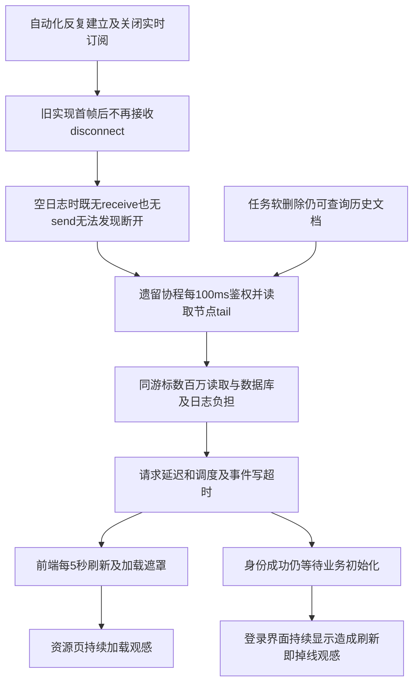

# 2026-10-30 自动化并发接入后的生产故障调查

## 目标与证据边界

用户报告自动化平台夜间并发创建设备/任务、订阅实时日志及删除后，资源页慢且持续加载，刷新后回登录页。本轮只读分析提供的API、Worker JSONL与浏览器HAR，不修改生产日志或公司服务。修复必须保持日志正文、历史下载、权限即时撤销与连接关闭证明不变量。

## 完整遍历结果

- API：82份JSONL，6,969,813行，2026-10-29 00:00:10至10-30 09:04:28（北京时间）；1行JSON不完整，不能分析该行正文。
- Worker：3份JSONL，145,386行，10-29 00:00:00至10-30 09:06:20。
- 浏览器：google-capture为HAR 1.2，84条记录，其中30次API全200。覆盖09:06:50–09:08:25，晚于API日志结束的09:04:28，因此不能按请求ID伪造两份证据的直接对应。
- API中6,909,056条来自httpx。两个任务的固定游标被重复读取3,555,106次和1,744,865次；两任务分别在03:07:35及05:38:44收到删除202后仍被读取至09:04。202仅表示删除受理，不推断设备连接当时已关闭。
- 10/30 02点内部tail请求863,767次，08点仍800,198次；同期1,520次调度TimeoutError，9,851次请求事件持久化超时。
- GET /resources成功6,262次，P50 221.609ms，P99 3,787.252ms；GET /health P99 1,511.628ms。此处为日志内请求耗时，不代表浏览器端总耗时或数据库独立执行时间。
- Worker另见91,444次ALREADY_ASH、两任务734次SshSlotUncertain收尾失败、796次归档补偿登记失败，分别继续检查去重、未知名额恢复与目录登记原因。不得以清除pending或真实日志解决。

## 修复范围与验收要求

- 高频httpx正常请求不再逐条进入INFO日志队列，保留WARNING及平台自身访问日志；专项新增测试先红后绿，日志专项15项通过。
- 已修复空闲订阅断开/删除后的轮询回收：持续观察断开，取消并等待在途操作；已删除或确认停止且释放节点的任务以1000关闭，暂停任务保留订阅。
- 前端身份恢复与业务初始化分离；正常恢复不显示可重复提交的登录表单，业务读取失败不清除有效身份。资源相同条件请求合并、后台刷新保留表格，切换条件和变更后的强制刷新取消旧请求并阻止迟到结果覆盖。
- 完成后运行后端/前端/浏览器/隔离并发验收，提交并等待全部CI。不得以短时本机结果证明生产24小时容量，或承诺任意网络与数据库故障绝不会再发生。

## 浏览器问题的直接证据与复现

HAR中两次刷新后的auth/me均200，没有401及X-Auth-Required:true。第一次恢复读取3.387秒，尚未完成时用户又提交登录；第二次auth/me成功后，任务/模板/节点初始化还在进行，界面仍可提交登录。旧establish等待全部初始业务读取后才设置authenticated，而App未区分恢复中与未登录。这不是抓包所示会话被服务器强制注销；Cookie字段未被HAR保留，不能据此声称Cookie丢失。

资源16次读取全部200，中位3.593秒、最大7.744秒，约每5秒一次；首屏相隔0.785秒的两次读取重叠。挂载加载与导航刷新重复触发，慢响应及每轮loading遮罩造成持续重载的观感。初始化失败也会被旧restore当作退出，属于需回归的额外错误路径，但本HAR无失败响应，不能说现场已命中该路径。

## 并发回归

新增scripts/verify_automation_churn.py，真实本机Mongo副本集、HTTP/WebSocket端口与服务账号权限校验；仅Worker tail为无正文模拟源，生产采集另有隔离Worker验收。4轮×12并发，48资源/48任务通过正式API创建删除，24连接主动断开、24订阅中删除；每轮等待并确认tail请求数不再增长，历史软删除记录保留。最终鉴权优化版通过，46次并行资源查询P50 6.810ms、P99/最大19.651ms。随机库与临时目录已清理。该短时本机结果不等同公司网络、长时间或500路容量。

请求事件落库失败的JSONL追加同一requestId、method和route，便于数据库拥塞时仍能关联原请求。未增加事件写入超时时间，也未把数据库失败转为业务成功。日志与请求日志专项30项通过。

## 根因链与证据限制

本机复现验证了断开/删除回收缺陷；生产同游标大量读取、删除后持续读取与渐进超时支持该链路。现有日志没有Mongo服务端profile、宿主CPU/IO完整时间序列，不能计算各种负载各占多少延迟，也不能仅凭相关性排除公司网络或磁盘的叠加因素。

旧HEAD 196abfd使用相同真实Mongo/HTTP/WebSocket脚本，在第一轮订阅中删除任务后等待关闭超过5秒，明确失败；修复版4轮48次全部通过。默认及包含已删除资源、本人/共享筛选的既有真实Mongo Explain本轮复核：返回20行分别扫描20/21个索引键、20份文档；这组资源列表既有索引无需新增；用户随后追加数据库全面优化要求，任务摘要与待处理操作的新索引另行验证，不能把生产慢全部归为缺索引。

## Worker独立问题的复核

- 精确重数：145,386行全部可解析，96,222次调试交互中91,444次ALREADY_ASH；734次运行释放失败。早期摘要的归档失败797次有一条计数误差，完整原始文件重新计数为796次（10/29为613、10/30为183），本文采用复核值。
- 796条栈均在archive_spool.load读取扫描候选spool自身时FileNotFoundError；证明候选在读取时已消失，无法证明由哪个发布/删除动作移除。修复只处理候选自身缺失；引用内容缺失继续报警，不删除待办或日志。
- 3条后台目录登记InvalidOperation在10/29 20:23:12指向同一task/run/archive，但日志只有errorType，没有消息或栈。现有证据不能确认具体数据库操作原因，不能声称已复现并修复它们。
- ASH确认分别记忆事件与任务状态成功，重复确认不反复写日志/任务；任何未成功持久化阶段仍可在后续确认重试。
- 预建连名额结果未知原先只重复抛出同一不确定标志，无法自行协调。新恢复只针对明确发生在socket创建之前的申请，以端点admissionEpoch围栏阻断旧代次迟到申请，再精确回收同token/运行/代次名额。已建立连接的未知关闭仍维持隔离；没有socket的协调不伪造物理关闭收据。随机真实Mongo副本集已验证首次申请竞争、旧代次upsert拒绝、协调重试与无关claim保留；该脚本继续纳入既有容器CI。

## 鉴权数据库往返与日志优化

- 普通REST和实时订阅不再为界面“API文档”入口查询用户的服务账号目录；登录、当前身份和改密响应仍实时计算入口资格。Bearer请求已验证当前令牌，直接使用该结果证明入口资格。每次请求及订阅轮询仍查询当前会话/令牌和用户，不缓存跨请求授权，停用、撤销和到期收权保持生效。
- IP策略在同一个HTTP请求中只读取一次，供中间件与路由共用；下一HTTP请求重新读取。WebSocket是长连接，每轮仍重新校验，不能沿用连接建立时的策略快照。新增查询预算和撤销回归先失败后通过。
- 保留平台访问、业务审计、真实失败与依赖WARNING；抑制正常httpx INFO洪泛和已成功持久化的重复ASH确认。后台目录登记异常增加脱敏栈位置，不写设备正文、凭据和原始异常消息。

## 交付边界

本轮不访问公司数据库，也不修改提供的原始日志。新增索引验证使用随机本机真实Mongo数据库，不能据此声称已检查公司实例的实际索引目录、慢查询profile或磁盘状态。公司升级后应复核受控创建索引成功、尾读与会话数不随自动化轮次持续增长、请求及调度延迟恢复；长时负载容量仍需要现场验收。

## 本机验证记录

- 后端全量：2,176项通过；前端44个测试文件、225项通过；生产构建与Ruff通过。包含索引查询形状调整及独立审查发现的中间事件落库失败恢复回归。
- `scripts/verify_isolated_browser_smoke.py`：真实API、Worker、WebSocket和浏览器小时下载通过，随机数据库和日志目录自动清理。
- 35组生产构建浏览器验收全部通过，包含慢身份恢复、业务初始化失败重试、资源静默刷新/旧响应隔离、服务端1000停止重连和本地onerror正常重连；1440/390截图目检。
- 功能提交 `6d86792` 的 [CI41009273392](https://github.com/geekingdom/camera-log-record-server/actions/runs/41009273392) 九项全部成功；含后端、前端、NFS、Elasticsearch、跨Worker、容器、独立组件、原生部署与中文提交规范。

## 索引与实际查询计划

新增 `tasks_resource_visible_summary(resourceId)`、`tasks_serial_resource_visible_summary(serialServerResourceId)`，仅索引未删除任务；`operations_task_pending_intent(taskId,status,desiredState)` 仅索引PENDING操作。原索引保留，未新增集合或TTL。资源摘要的两个关联分支分别声明 `deletedAt:null`，兼容缺失字段的旧任务；仅建索引而保持原查询形状时，实测仍走旧索引，因此本轮同步调整查询。

验证器调用生产 `_add_task_summaries`，截获并执行真实aggregate管道、校验汇总，再对同一管道Explain；没有hint强制计划。随机库包含6000任务，500条目标任务跨普通资源和串口关联，部分旧任务缺少deletedAt。MongoDB 8.0重复初始化通过，结果如下：

| 查询 | 升级前键/文档扫描 | 升级后键/文档扫描 | 返回 | 说明 |
| --- | --- | --- | --- | --- |
| 当前页资源任务汇总 | 2000 / 2000 | 504 / 500 | 500 | 实际命中两个关联部分索引，无阻塞排序 |
| 取消待处理操作 | 501 / 500 | 500 / 500 | 500 | 旧索引亦有效；新索引只覆盖待处理集合，不夸大本样本收益 |

查询计划受数据分布和版本影响。CI实际MongoDB 7.0执行同一生产聚合管道：升级前2001键/2000文档，升级后504键/500文档，两个关联索引均命中；待处理操作同为旧501键/500文档、新500键/500文档。重复初始化及汇总结果检查通过。公司的实际索引目录和profile不在所提供证据中。

## Linux CI并发与清理证据

CI四轮共48次资源/任务创建删除与订阅回收，每轮残留tail调用均为0；58次并行资源查询P50 8.142ms、P99/最大151.285ms。这是GitHub运行器短时混合负载，与本机19.651ms或公司原始3.787s均不是受控同环境性能倍数比较。

所有随机数据库、隔离采集日志和下载副本由验证器回收；主线程确认本轮专属副本集仅有admin/config/local后关闭并删除其专属数据目录，未清空工程.local/logs或NFS证据。截图与精简调查报告保留。
